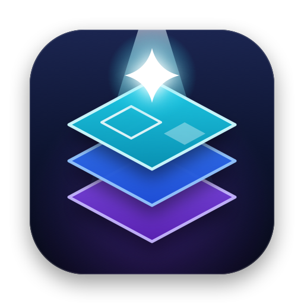

<p align="center">
  
</p>

<h1 align="center">Lumen</h1>

<p align="center">A UI debugger for iOS and macOS apps: inspect view hierarchies in layered 3D, and read the same data from the command line or through MCP for scripts, CI and AI assistants.</p>

<p align="center"><a href="README.md">简体中文</a></p>

## Features

Lumen inspects the view hierarchy of a running app and exposes the same capabilities to the command line and AI assistants. It supports macOS AppKit apps and can inject itself without any project changes.

| Feature | Details |
|---|---|
| 2D / 3D canvas | Metal rendering; flat and exploded 3D views, adjustable layer spacing, camera reset, hidden nodes and wireframes, spacing measurements |
| Hierarchy outline | Tree outline linked with the canvas; filter by class name, text and more |
| SwiftUI | Shows the SwiftUI logical view tree under each hosting view: `Text` strings, controls such as `Button` / `Toggle` / `TextField`, modifier chains with arguments, and property values from the debug data (including `@State`); searchable by text. Enabled automatically when LumenServer is linked or injected |
| Inspector | Attributes grouped by class, class chain, owning view controller, ivar name, accessibilityIdentifier, window coordinates |
| Live attribute editing | Edit attributes in the inspector (drag to nudge numbers, color picker, text…); changes are logged, undoable and can be copied as an AI prompt. CLI: `lumen set` |
| Method invocation | List and call methods on a node, its layer or its view controller from the console. CLI: `lumen methods` / `lumen invoke` |
| Gesture toggles | Inspect gesture recognizers (state, target/action, delegate) and enable or disable each one. CLI: `lumen gestures` |
| Constraint diagnostics | Auto Layout ambiguity, intrinsic size, hugging / compression priorities and every constraint affecting the node. CLI: `lumen constraints` |
| Hit-test diagnostics | Explains which view a point hits, why others were skipped, the responder chain and candidate gestures. CLI: `lumen hittest` |
| Accessibility | Lists accessibility elements in VoiceOver order (label, value, hint, traits). CLI: `lumen a11y` |
| Appearance overrides | Switch dark mode, Dynamic Type size and right-to-left layout at runtime. CLI: `lumen appearance` |
| Audit | Finds small touch targets, truncated text, low contrast, occlusion, ambiguous layout, missing accessibility and more; export reports, tune thresholds, gate CI. CLI: `lumen audit` |
| Timeline | Every hierarchy change while connected is recorded; browse past snapshots and compare any two points in time |
| Design comparison | Overlay a reference image on the canvas (overlay / difference modes, adjustable opacity), align it to a window and get a match score |
| Copy & export | Copy class name, Lumen selector, node description, an AI-ready prompt; export node screenshots |
| Auto refresh | Refresh on an interval and whenever the app reports hierarchy changes |
| Selector queries | CSS-like syntax: class names, `#identifier`, `[text*="Login"]`, `:visible`, descendant / child combinators |
| `.lumen` archives | Save the hierarchy, all node details and textures into one `.lumen` file (app menu "导出快照…" (Export Snapshot) or `lumen archive save`); open it offline in the app, or query, audit and diff it from the CLI |
| JSON snapshots & diff | `lumen snapshot save` writes a JSON hierarchy snapshot (`lumen.snapshot` format); diff it against another snapshot or the live UI (usable as a CI assertion) |
| Command line | `lumen` covers app discovery (this Mac, USB devices, LAN), hierarchy, queries, node details, screenshots, snapshots and archives, audits, live editing, source lookup and injection |
| AI assistants | `lumen mcp` runs as an MCP server with tools for hierarchy, queries, node details, screenshots, snapshot diffs, audits, hit-testing, constraints, accessibility, attribute editing, method calls, appearance overrides and source lookup |
| Zero-change injection | `lumen launch` injects the server into a macOS app or an app in the iOS Simulator |
| Platforms | Debugged apps: iOS, tvOS, visionOS (UIKit) and macOS (AppKit); visionOS requires Swift Package Manager. Client: macOS 14 or later |

## Download

Download the build for your Mac from [Releases](https://github.com/wangwanjie/Lumen/releases/latest):

| Chip | Download |
|---|---|
| Apple silicon (M series) | [Lumen_arm64.dmg](https://github.com/wangwanjie/Lumen/releases/latest/download/Lumen_arm64.dmg) |
| Intel | [Lumen_x86_64.dmg](https://github.com/wangwanjie/Lumen/releases/latest/download/Lumen_x86_64.dmg) |

Open the DMG and drag Lumen into Applications. Builds are notarized by Apple and update themselves (menu Lumen → Check for Updates…).

## Integrating the app you debug

The `LumenServer` collector belongs in Debug builds only. Pick one of three options.

### 1. Swift Package Manager

In Xcode choose File → Add Package Dependencies, enter `https://github.com/wangwanjie/Lumen.git` and add `LumenServer` to your app target, or in `Package.swift`:

```swift
dependencies: [
    .package(url: "https://github.com/wangwanjie/Lumen.git", from: "0.1.0"),
],
targets: [
    .target(name: "MyApp", dependencies: [
        .product(name: "LumenServer", package: "Lumen"),
    ]),
]
```

Start it at launch:

```swift
#if DEBUG
import LumenServer
#endif

// e.g. in application(_:didFinishLaunchingWithOptions:) or applicationDidFinishLaunching:
#if DEBUG
LumenServer.start()
#endif
```

SwiftPM links dependencies in every configuration, so Release builds still link LumenServer; `#if DEBUG` keeps it from starting. Use CocoaPods if Release builds must not contain the collector at all.

### 2. CocoaPods (Debug only)

```ruby
pod 'LumenServer', :podspec => 'https://raw.githubusercontent.com/wangwanjie/Lumen/v0.1.0/LumenServer.podspec', :configurations => ['Debug']
```

The code is the same as above.

### 3. Zero-change injection: `lumen launch`

```bash
LUMEN=/Applications/Lumen.app/Contents/Helpers/lumen

# A macOS app (executable or .app)
$LUMEN launch --mac /path/to/MyApp.app

# An app installed in the iOS Simulator (booted or a simulator UDID)
$LUMEN launch --simulator booted com.example.MyApp
```

The injection libraries ship inside `/Applications/Lumen.app/Contents/Helpers/` and `lumen` finds them automatically. SIP-protected system apps and apps using the Hardened Runtime without allowing DYLD environment variables cannot be injected; use one of the first two options for those.

Then open Lumen: it discovers apps on this Mac and connects automatically; switch between apps from the toolbar.

## Debugging on a device

### USB (recommended)

By default the collector listens on the device's loopback address only; USB connections arrive through usbmuxd, so no extra setup is needed:

1. Integrate LumenServer as above (call `LumenServer.start()` in Debug builds), then install and run the app on your iPhone / iPad;
2. Connect it to this Mac with a cable and tap "Trust This Computer" on the device;
3. Open Lumen and pick the app from the toolbar's app list, grouped under "USB 设备：<device name>" (USB devices); the list refreshes as soon as a device is plugged in or out.

From the command line:

```bash
lumen devices                                   # USB devices and their UDIDs
lumen apps                                      # Lumen-enabled apps on this Mac and on USB devices
lumen --device <UDID> hierarchy --depth 4       # only apps on that device
```

### LAN (wireless)

The client discovers LAN apps through the Bonjour service `_lumen._tcp`, so the app must enable network connections, which also advertises that service:

1. Set the Boolean `LumenAllowsNetworkConnections = YES` in the host app's Info.plist (and keep calling `LumenServer.start()`), or call `LumenServer.start(allowsNetworkConnections: true)`;
2. Declare local network access in Info.plist:

```xml
<key>NSLocalNetworkUsageDescription</key>
<string>Used by Lumen UI debugging (Debug builds only)</string>
<key>NSBonjourServices</key>
<array>
    <string>_lumen._tcp</string>
</array>
```

3. Allow local network access on the device the first time the app runs;
4. Enable "发现局域网设备" (discover LAN devices) in Lumen's settings, or pass `--network` on the command line (e.g. `lumen apps --network`).

## AI assistants (MCP)

`lumen mcp` runs a [Model Context Protocol](https://modelcontextprotocol.io) server with tools to list and select apps, read the hierarchy, run selector queries, find text, read node details, take screenshots, diff snapshots, audit, hit-test, inspect constraints and accessibility, edit attributes, invoke methods, override appearance and locate source code.

Claude Code:

```bash
claude mcp add lumen -- /Applications/Lumen.app/Contents/Helpers/lumen mcp
```

Clients configured with `mcpServers` (Cursor and others):

```json
{
  "mcpServers": {
    "lumen": {
      "command": "/Applications/Lumen.app/Contents/Helpers/lumen",
      "args": ["mcp"]
    }
  }
}
```

## Command line cheat sheet

```bash
sudo ln -sf /Applications/Lumen.app/Contents/Helpers/lumen /usr/local/bin/lumen
```

| Command | Purpose |
|---|---|
| `lumen apps` | List running apps that embed Lumen (this Mac and USB devices; LAN with `--network`) |
| `lumen devices` | List USB-connected devices (UDIDs) |
| `lumen hierarchy [--depth N] [--visible]` | Print the hierarchy, one node per line |
| `lumen query 'UIButton[text*="Login"]:visible'` | Find nodes by selector |
| `lumen node 12` | Node details: class chain and attributes grouped by class |
| `lumen screenshot 12 -o node.png` | Save a node screenshot |
| `lumen snapshot save before.json` | Save a JSON hierarchy snapshot (for diffing) |
| `lumen snapshot diff before.json --exit-code` | Diff against the live UI; exit code 1 when different |
| `lumen archive save current.lumen` | Save a full archive (hierarchy, node details, textures) that the app opens offline |
| `lumen audit --fail-on error` | Audit the UI; exit code 1 when error-level findings exist |
| `lumen set 12 UIView.alpha 0.5` | Change an attribute at runtime |
| `lumen launch --mac <App>` | Launch with zero-change injection |
| `lumen mcp` | Run as an MCP server |

Global options: `--json` for stable JSON output, `--app <name|bundle id|pid|UDID>` to pick the target app, `--device <UDID|name>` to limit to one device, `--network` to also discover LAN apps, `--port N` to connect directly. The CLI's own messages are in Chinese; run `lumen help <command>` for details.

## Privacy & security

- Integrate the collector in Debug builds only: wrap the start call in `#if DEBUG` with SwiftPM, use `:configurations => ['Debug']` with CocoaPods.
- By default it listens on the loopback address (127.0.0.1) only and rejects connections from other hosts; this is how the Simulator, Mac apps and USB-connected devices connect.
- LAN access must be enabled explicitly: set `LumenAllowsNetworkConnections = YES` in Info.plist or call `LumenServer.start(allowsNetworkConnections: true)`; it then listens on all interfaces and advertises the Bonjour service `_lumen._tcp` (see "Debugging on a device").
- Text in secure text fields (passwords) is always returned masked and never leaves the debugged app.
- Data flows only between Lumen, `lumen` and the debugged app on your machine; nothing is uploaded.

## License

Lumen.app, the `lumen` CLI and the LumenServer SDK are free to use and distributed as binaries only; you may integrate the SDK into Debug builds of your own apps, but may not decompile, modify or redistribute it on its own. See [LICENSE](LICENSE). © 2026 wangwanjie. All rights reserved.
